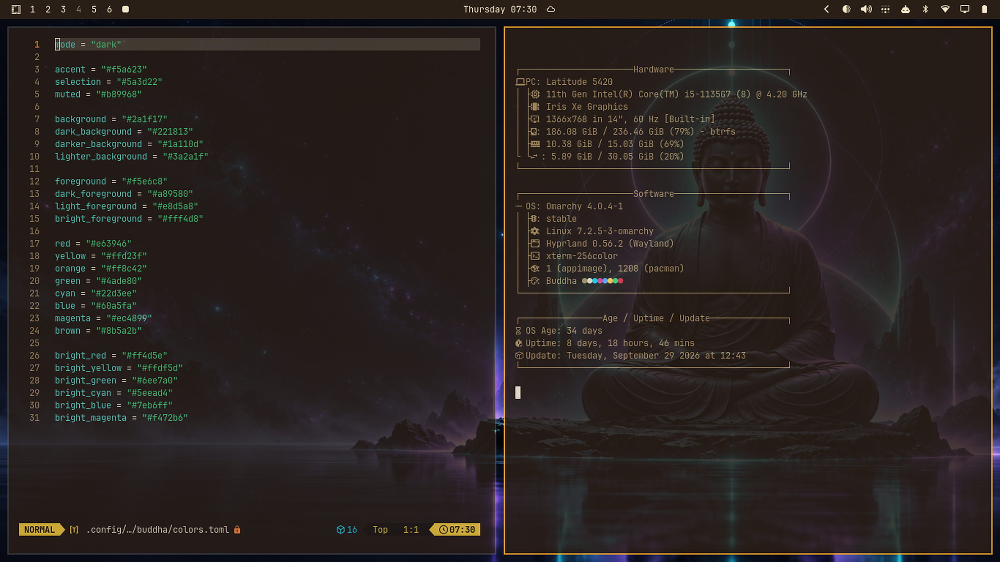
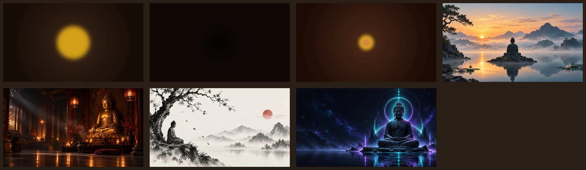

# Buddha

A dark Omarchy theme in saffron, ink, and still water. The palette is warm brown and gold. Seven wallpapers sit behind it, each with a short video intro: a meditation glow, a dark temple field, a saffron sun, a sunset lake, a candlelit shrine, an ink drawing, and a violet night sky.



`preview.png` is the image the theme switcher loads. It is a 2560×1440 screenshot of a live Buddha desktop — waybar, an editor, and a terminal over the cosmos wallpaper — matching the size of the bundled Omarchy theme previews.



## Install

The repository name `omarchy-buddha-theme` installs as **buddha**.

```bash
omarchy theme install https://github.com/richfeather-cpu/omarchy-buddha-theme.git
```

Omarchy clones that URL into `~/.config/omarchy/themes/buddha` and applies the theme. The same install is under **Install > Style > Theme** in the Omarchy menu (`Super + Alt + Space`).

Switch back to it later with **Style > Theme**, `Super + Ctrl + Shift + Space`, or:

```bash
omarchy theme set buddha
```

Cycle wallpapers with `Super + Ctrl + Space`. When a wallpaper has a matching intro, Omarchy plays that clip as you switch to it. Toggle intros with `omarchy theme bg intro toggle`.

Omarchy builds the terminal, editor, browser, bar, menu, notifications, and lock screen from `colors.toml`. This theme ships that palette and the files below. It does not ship per-app config files, and an installed copy drops anything that would run code (there is none here).

| File | Role |
| --- | --- |
| `colors.toml` | Palette. `mode = "dark"`. |
| `backgrounds/` | Seven wallpapers, in filename order. The wallpaper cycler only reads files in this directory, not subfolders. |
| `backgrounds/intros/` | Five-second video intros, named to match each wallpaper. Omarchy plays `backgrounds/intros/<stem>.mp4` when that wallpaper is shown. |
| `screensaver.txt` | Braille Buddha with a golden halo, the same drawing as `screensavers/01_golden_halo.txt`. |
| `icons.theme` | `Yaru-wartybrown`, so the file manager follows the earth tones. Delete this file to keep your current icons. |
| `preview.png` | Theme-switcher thumbnail, 2560×1440. Omarchy looks for this name at the repository root. |
| `wallpapers.png` | Contact sheet of the seven wallpapers, for this page. The switcher ignores it. |
| `screensavers/` | Four ASCII pieces, plain and colored. |

### Wallpapers

| File | Scene | Size |
| --- | --- | --- |
| `1-meditation.png` | Saffron orb on a dark brown field | 3840×2160 |
| `2-temple.png` | Nearly black temple field | 3840×2160 |
| `3-saffron.png` | Soft saffron sun on a brown field | 3840×2160 |
| `4-lotus.webp` | Sunset over a lake, pines and mountains | 1672×941 |
| `5-shrine.webp` | Candlelit temple hall | 1672×941 |
| `6-sumie.webp` | Ink-wash figure under a branch, red seal | 1672×941 |
| `7-cosmos.webp` | Seated figure in a violet halo, night sky | 1672×941 |

### Video intros

Each wallpaper has a matching intro created with ChatGPT. The clips are silent H.264 MP4 files, 1920×1080, 30 fps, and five seconds long: a warm fade-in, a gentle camera settle, brief drifting gold dust, and a short hold on the still.

Omarchy resolves intros as `backgrounds/intros/<wallpaper-stem>.mp4`. They live in that subdirectory so the wallpaper cycler, which only lists the top of `backgrounds/`, will not treat them as backgrounds.

| Wallpaper | Intro | Size |
| --- | --- | --- |
| `1-meditation.png` | `backgrounds/intros/1-meditation.mp4` | 464 KB |
| `2-temple.png` | `backgrounds/intros/2-temple.mp4` | 117 KB |
| `3-saffron.png` | `backgrounds/intros/3-saffron.mp4` | 528 KB |
| `4-lotus.webp` | `backgrounds/intros/4-lotus.mp4` | 1.7 MB |
| `5-shrine.webp` | `backgrounds/intros/5-shrine.mp4` | 1.8 MB |
| `6-sumie.webp` | `backgrounds/intros/6-sumie.mp4` | 1.5 MB |
| `7-cosmos.webp` | `backgrounds/intros/7-cosmos.mp4` | 1.5 MB |

### Palette

| Role | Hex |
| --- | --- |
| background | `#2a1f17` |
| foreground | `#f5e6c8` |
| accent | `#f5a623` |
| selection | `#5a3d22` |
| muted | `#b89968` |

The neutral ramp runs from `darker_background` `#1a110d` up to `bright_foreground` `#fff4d8`.

## Remove the theme

**Remove > Style > Theme**, or:

```bash
omarchy theme remove buddha
```

## Listing

Two different images, in two different places.

The theme switcher, and galleries that read the repository, use `preview.png` at the root of this repo. `omarchy-theme-switcher` checks these root filenames, in order: `preview.png`, `preview.jpg`, `preview.jpeg`, `preview.webp`, `preview.gif`, `preview.bmp`, then a short list of video extensions. The first match wins. This repo ships `preview.png`.

[omarchy.org/themes](https://omarchy.org/themes/) does not read that file. Listings are a pull request to [omacom-io/omarchy-site](https://github.com/omacom-io/omarchy-site). The screenshot in that pull request has to be a real desktop. This repository's `preview.png` is already one; a listing still needs the smaller site asset:

1. Start from `preview.png` in this repository, or apply the theme (`omarchy theme set buddha`) and take a 16:9 shot of a live session.
2. Include a terminal and an editor. Use one of the wallpapers in `backgrounds/`.
3. Leave out the pointer, notifications, and anything personal. Do not upscale a small capture.
4. Convert it and add it to the site repository:

```bash
magick buddha-desktop.png -strip -resize '1200>' -quality 80 assets/themes/buddha.webp
```

Aim for about 1200×675 and under about 100KB. In `themes/index.html`, add the figure in alphabetical order. On the current page that is between Blue Ridge Dark and Castle on a Lake. Both links point at `https://github.com/richfeather-cpu/omarchy-buddha-theme`.

[omarchythemes.dev](https://omarchythemes.dev/docs/publishing) reads `colors.toml` and `preview.png` from this repository and imports the screenshot from the official listing. It does not ask for another filename here.

## Credits

Wallpapers and video intros generated with ChatGPT for this theme. The Braille and ANSI art was made for this theme.

Rich Feather, [richfeather-cpu](https://github.com/richfeather-cpu), 2026.

## License

[MIT](LICENSE). Copyright (c) 2026 Rich Feather.

The MIT license covers this whole repository: `colors.toml`, the ASCII art, `preview.png`, `wallpapers.png`, the wallpapers in `backgrounds/`, and the video intros in `backgrounds/intros/`.
