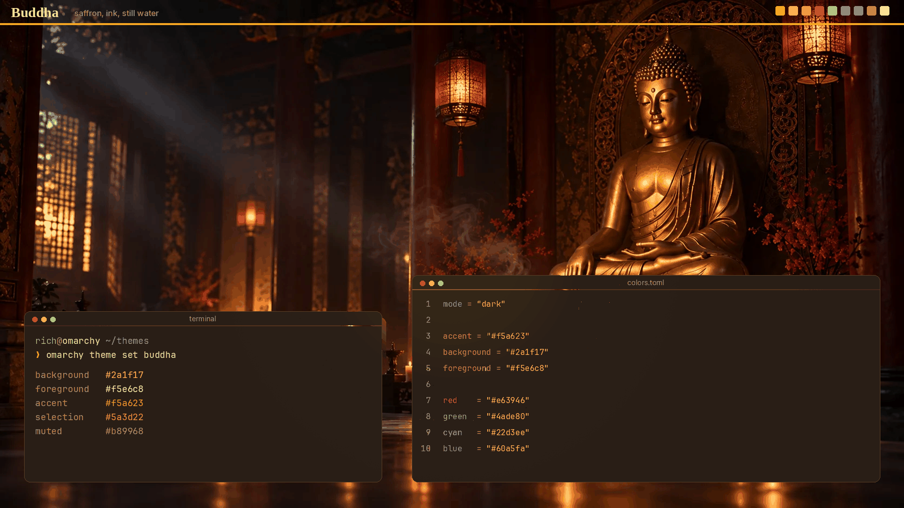
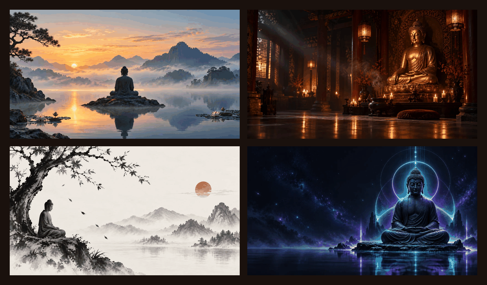

# Buddha

A dark Omarchy theme in saffron, ink, and still water. The palette is warm brown and gold. Four illustrated wallpapers sit behind it: a sunset lake, a candlelit shrine, an ink drawing, and a violet night sky.



`preview.png` is the image the theme switcher loads. It is 1800×1012, the same frame as the bundled Omarchy theme previews, composed from `backgrounds/2-shrine.webp` and `colors.toml`. It is not a photograph of a running desktop.



## Install

The repository name `omarchy-buddha-theme` installs as **buddha**.

```bash
omarchy theme install https://github.com/richfeather-cpu/omarchy-buddha-theme.git
```

Omarchy clones that URL into `~/.config/omarchy/themes/buddha` and applies the theme. The same install is under **Install > Style > Theme** in the Omarchy menu (`Super + Alt + Space`).

Switch back to it later with **Style > Theme**, `Super + Ctrl + Shift + Space`, or:

```bash
omarchy theme set buddha
```

Cycle wallpapers with `Super + Ctrl + Space`.

Omarchy builds the terminal, editor, browser, bar, menu, notifications, and lock screen from `colors.toml`. This theme ships that palette and the files below. It does not ship per-app config files, and an installed copy drops anything that would run code (there is none here).

| File | Role |
| --- | --- |
| `colors.toml` | Palette. `mode = "dark"`. |
| `backgrounds/` | Four illustrated wallpapers, in filename order. |
| `screensaver.txt` | Braille Buddha used by the optional screensaver. |
| `icons.theme` | `Yaru-wartybrown`, so the file manager follows the earth tones. Delete this file to keep your current icons. |
| `preview.png` | Theme-switcher thumbnail, 1800×1012. Omarchy looks for this name at the repository root. |
| `wallpapers.png` | Contact sheet of the four wallpapers, for this page. The switcher ignores it. |
| `screensavers/` | Four ASCII pieces, plain and colored. |

### Wallpapers

| File | Scene | Size |
| --- | --- | --- |
| `1-lotus.webp` | Sunset over a lake, pines and mountains | 1672×941 |
| `2-shrine.webp` | Candlelit temple hall | 1672×941 |
| `3-sumie.webp` | Ink-wash figure under a branch, red seal | 1672×941 |
| `4-cosmos.webp` | Seated figure in a violet halo, night sky | 1672×941 |

### Palette

| Role | Hex |
| --- | --- |
| background | `#2a1f17` |
| foreground | `#f5e6c8` |
| accent | `#f5a623` |
| selection | `#5a3d22` |
| muted | `#b89968` |

The neutral ramp runs from `darker_background` `#1a110d` up to `bright_foreground` `#fff4d8`.

## Screensaver

Omarchy draws its screensaver from one global file, `~/.config/omarchy/branding/screensaver.txt`, and animates that file with ttfx. Applying a theme does not change it. `screensaver.txt` in this repository is ready for that file: a Braille Buddha with a golden halo, the same drawing as `screensavers/01_golden_halo.txt`.

```bash
cp ~/.config/omarchy/themes/buddha/screensaver.txt ~/.config/omarchy/branding/screensaver.txt
```

That replaces whatever art is there today. The plain `.txt` files in `screensavers/` can replace the root `screensaver.txt` if you want the idle screensaver to show a different piece.

### Optional screensaver

The rotating player and the theme-switch hook live in [omarchy-buddha-screensaver](https://github.com/richfeather-cpu/omarchy-buddha-screensaver). They read `screensaver.txt` and `screensavers/` from `~/.config/omarchy/themes/buddha` after this theme is installed. This repository does not ship those scripts.

## Remove the theme

**Remove > Style > Theme**, or:

```bash
omarchy theme remove buddha
```

## Listing

Two different images, in two different places.

The theme switcher, and galleries that read the repository, use `preview.png` at the root of this repo. `omarchy-theme-switcher` checks these root filenames, in order: `preview.png`, `preview.jpg`, `preview.jpeg`, `preview.webp`, `preview.gif`, `preview.bmp`, then a short list of video extensions. The first match wins. This repo ships `preview.png`.

[omarchy.org/themes](https://omarchy.org/themes/) does not read that file. Listings are a pull request to [omacom-io/omarchy-site](https://github.com/omacom-io/omarchy-site). The screenshot in that pull request has to be a real desktop, so it is not in this repository:

1. Apply the theme (`omarchy theme set buddha`) and take one 16:9 shot of a live session.
2. Include a terminal and an editor. Use one of the wallpapers in `backgrounds/`.
3. Leave out the pointer, notifications, and anything personal. Do not upscale a small capture.
4. Convert it and add it to the site repository:

```bash
magick buddha-desktop.png -strip -resize '1200>' -quality 80 assets/themes/buddha.webp
```

Aim for about 1200×675 and under about 100KB. In `themes/index.html`, add the figure in alphabetical order. On the current page that is between Blue Ridge Dark and Castle on a Lake. Both links point at `https://github.com/richfeather-cpu/omarchy-buddha-theme`.

[omarchythemes.dev](https://omarchythemes.dev/docs/publishing) reads `colors.toml` and `preview.png` from this repository and imports the screenshot from the official listing. It does not ask for another filename here.

## Credits

Wallpapers generated with ChatGPT for this theme. The Braille and ANSI art was made for this theme.

Rich Feather, [richfeather-cpu](https://github.com/richfeather-cpu), 2026.

## License

[MIT](LICENSE). Copyright (c) 2026 Rich Feather.

The MIT license covers this whole repository: `colors.toml`, the ASCII art, `preview.png`, `wallpapers.png`, and the wallpapers in `backgrounds/`.
